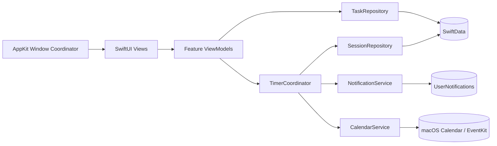
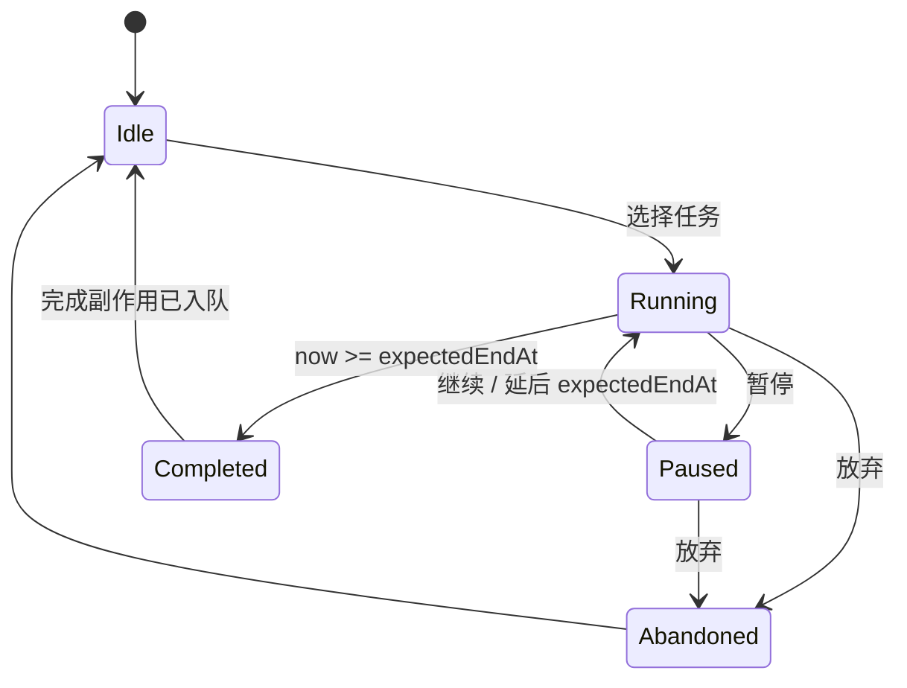
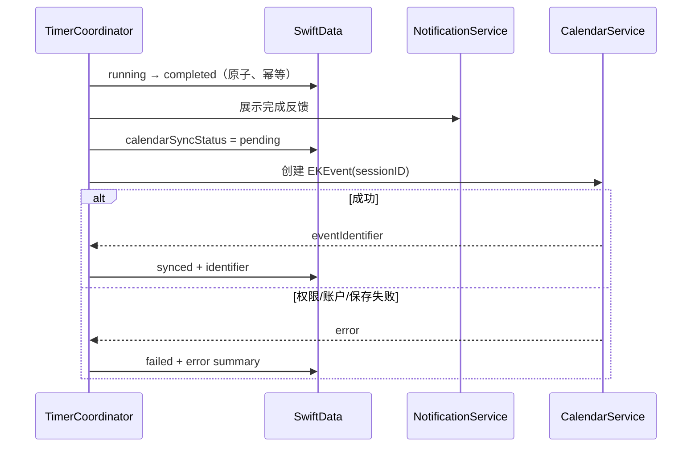

# DoNow macOS 应用架构评审稿

状态：Draft v0.1  
目标平台：macOS 14+（建议）  
技术路线：Swift 6、SwiftUI + AppKit、SwiftData、EventKit、UserNotifications

## 1. 产品目标

DoNow 是一款常驻 macOS 的轻量专注工具：

1. 桌面显示一个可拖动的悬浮球。
2. 点击悬浮球，弹出“想做什么？”和用户预设的待办列表。
3. 每个待办包含名称和单次预计时长。
4. 用户选择待办后立即开始倒计时。
5. 倒计时完成后，只记录一次完成，并将实际执行时段写入 macOS 日历。

首版不做账号、云端服务、团队协作或跨平台客户端。应用完全本地运行。

## 2. 首版范围与产品决策

### 2.1 MVP 包含

- 悬浮球：置顶、拖动、记住位置、支持多显示器边界修正。
- 任务模板：新增、编辑、删除、排序；字段为名称和预计时长。
- 单一活动计时器：同一时刻只能运行一个任务。
- 计时操作：开始、暂停、继续、放弃。
- 完成记录：保存开始时间、结束时间、计划时长、实际时长和同步状态。
- 完成提醒：本地通知和提示音。
- 日历写入：成功完成后创建日历事件；失败时可重试。
- 设置：默认日历、开机启动、通知和悬浮球行为。
- 历史记录：最小可用列表，用于查看结果和处理日历同步失败。

### 2.2 建议暂缓

- 多设备同步、账号体系、Web 后端。
- 同时运行多个计时器。
- 番茄钟循环、统计图表、标签体系。
- 全局快捷键；可作为第二阶段功能，因为沙盒、键盘监听和权限体验需要单独设计。

### 2.3 需要产品确认的语义

本方案默认采用以下规则：

- 只有自然倒计时结束才算“完成”；用户提前停止记为“放弃”。
- 日历事件的时间段为实际开始时间至计划结束时间。
- 暂停期间不计入实际专注时长，结束时间相应顺延。
- 睡眠期间时间继续流逝；唤醒时若已到期，立即结算一次。
- 日历不可写不阻塞本地完成记录，后续可以重试同步。

## 3. 总体架构

采用单进程、模块化单体架构。首版没有必要引入 XPC helper 或后台服务器。



依赖方向保持为 `UI → Application → Domain ← Infrastructure`。业务状态不直接依赖窗口、EventKit 或通知框架，便于单元测试。

## 4. 模块划分

| 模块 | 责任 | 主要技术 |
|---|---|---|
| AppShell | 生命周期、菜单栏入口、窗口协调、权限引导 | SwiftUI App, AppKit |
| FloatingBall | 悬浮球渲染、拖动、屏幕吸附、位置保存 | `NSPanel` + SwiftUI hosting |
| TaskPicker | “想做什么？”弹层、任务选择 | SwiftUI |
| TaskManagement | 任务模板 CRUD、排序、时长校验 | SwiftUI + repository |
| TimerDomain | 计时状态机、恢复、暂停、完成幂等性 | 纯 Swift actor/service |
| History | 完成与放弃记录、同步错误展示 | SwiftUI + SwiftData |
| CalendarIntegration | 权限、日历选择、事件创建、重试 | EventKit |
| NotificationIntegration | 到期本地通知、取消与重建 | UserNotifications |
| Settings | 开机启动及用户偏好 | AppStorage, ServiceManagement |

## 5. UI 与窗口结构

### 5.1 悬浮球窗口

用 `NSPanel` 承载 SwiftUI 内容，而不是普通 SwiftUI 主窗口。建议配置：

- 无标题栏、透明背景、无阴影或自定义阴影。
- `level = .floating`，在普通应用窗口之上。
- `collectionBehavior` 包含跨 Space 显示和全屏辅助行为；全屏应用中的显示策略应提供开关。
- 默认不抢夺键盘焦点，点击展开面板时才按需成为 key window。
- 拖动结束保存“显示器标识 + 相对坐标”，屏幕变化后将位置夹回可视区域。

### 5.2 任务弹层

点击悬浮球后展示独立 `NSPanel`，锚定在球体附近：

- 标题：“想做什么？”
- 每行显示任务名和预计时长，例如“读书 · 25 分钟”。
- 单击任务即开始；为防误触，可在设置中启用二次确认。
- 点击面板外、按 Esc 或再次点击悬浮球时关闭。

### 5.3 运行态

计时开始后，悬浮球显示圆环进度和剩余时间。点击后显示当前任务、暂停/继续、放弃。设置和历史通过菜单栏图标或右键菜单进入，避免让悬浮球承担全部导航。

## 6. 领域模型

### TaskTemplate

| 字段 | 类型 | 说明 |
|---|---|---|
| id | UUID | 主键 |
| name | String | 1–80 字符 |
| estimatedDurationSeconds | Int | 建议限制 60 秒–24 小时 |
| sortOrder | Int | 用户排序 |
| isArchived | Bool | 保留历史关联，不物理删除 |
| createdAt / updatedAt | Date | 审计字段 |

### FocusSession

| 字段 | 类型 | 说明 |
|---|---|---|
| id | UUID | 主键，也是幂等键来源 |
| taskID | UUID? | 任务模板被归档后仍可追踪 |
| taskNameSnapshot | String | 防止任务改名影响历史 |
| plannedDurationSeconds | Int | 开始时快照 |
| startedAt | Date | 首次开始时间 |
| expectedEndAt | Date | 当前预计结束时间 |
| pausedAt | Date? | 暂停起点 |
| totalPausedSeconds | Int | 累计暂停 |
| finishedAt | Date? | 实际结算时间 |
| status | enum | running / paused / completed / abandoned |
| calendarSyncStatus | enum | notRequested / pending / synced / failed |
| calendarEventIdentifier | String? | EventKit 事件标识 |
| calendarSyncError | String? | 可展示的失败摘要 |

约束：数据库中最多存在一个 `running` 或 `paused` 会话。由于 SwiftData 不适合依赖部分唯一索引，应用启动和开始任务时都执行一致性检查。

## 7. 计时状态机



### 7.1 可靠计时原则

- 权威数据是持久化的 `expectedEndAt`，不是 `Timer` 的 tick 次数。
- UI 每秒用 `max(0, expectedEndAt.timeIntervalSince(now))` 计算显示值。
- 进入后台、唤醒、系统时间变化和应用启动时重新协调状态。
- 开始计时时立即保存会话，再安排本地通知。
- 到期结算采用事务式幂等流程：只有从 `running` 成功转为 `completed` 的调用者可以触发完成副作用。

### 7.2 应用退出时的现实边界

本地通知可在应用未运行时由系统送达，但通知触发本身不保证应用代码立即执行。因此：

- 用户正常退出应用时，保留活动会话和已安排通知。
- 下次启动时发现 `expectedEndAt <= now`，立即补做本地完成结算和日历同步。
- 若产品要求“应用退出后，到点必须无延迟写入日历”，则需要额外的 LoginItem/LaunchAgent helper；不建议纳入 MVP，因为复杂度和审核面显著增加。

## 8. 完成与日历同步流程



日历事件建议内容：

- 标题：`DoNow · {任务名称}`（可配置）。
- 开始/结束：会话的实际开始与计划结束；若补结算，不使用应用重启时间。
- 备注：写入稳定标记 `DoNow Session: <UUID>`，辅助诊断和人工去重。
- 日历：用户选择的可写日历；若其被删除或变为只读，回退到默认可写日历并提示。

首版仅需申请 EventKit “仅写入”权限。只有在产品需要列出用户真实日历名称、查询或修改既有事件时，才升级为完整访问。沙盒应用需 Calendar entitlement，并在 Info.plist 提供写入权限用途说明。

## 9. 权限与失败策略

权限按使用时请求，不在首次启动集中轰炸用户：

| 权限/能力 | 请求时机 | 拒绝后的行为 |
|---|---|---|
| 通知 | 首次开始计时前的解释页 | 计时可继续，UI 标记“不会到期提醒” |
| 日历写入 | 首次启用“写入日历”或首次完成前 | 本地照常完成，记录为待同步 |
| 开机启动 | 用户主动打开设置开关 | 展示系统状态和设置入口 |

失败分级：

- 可恢复：暂时保存失败、日历账户不可用，保留 `failed` 并允许重试。
- 需用户行动：权限拒绝、选定日历消失，展示跳转系统设置或重新选择。
- 数据损坏：启动时隔离异常记录，绝不重复创建日历事件。

## 10. 数据一致性与幂等

日历写入跨越本地数据库和系统 EventKit，无法使用同一个事务，因此采用本地 outbox 思路：

1. 先将会话提交为 `completed + pending`。
2. 再调用 EventKit。
3. 成功后存储 `calendarEventIdentifier` 并标记 `synced`。
4. 失败保留状态，稍后指数退避或由用户手动重试。

必须避免“EventKit 已保存，但应用在写回 identifier 前崩溃”造成重复事件。建议把 session UUID 写入事件备注；重试前如只有写权限而无法查询，则优先采用保守策略：将该类不确定结果标为“需要用户确认”，而不是自动盲重试。若业务强烈要求全自动去重，应申请完整日历访问并按 UUID 查询。

## 11. 应用生命周期与开机启动

- 默认作为 accessory app 运行，可隐藏 Dock 图标；设置窗口打开时仍能正常激活。
- 用户可选择开机启动。macOS 13+ 使用 `SMAppService.mainApp`，不需要独立 helper。
- 监听 workspace 唤醒通知，并在 `scenePhase` / app activation 时执行 `reconcileActiveSession()`。
- 单实例策略：第二次启动时激活已有实例并展开任务面板。

## 12. 建议工程目录

```text
DoNow/
├── App/
│   ├── DoNowApp.swift
│   ├── AppDelegate.swift
│   └── AppEnvironment.swift
├── Domain/
│   ├── Models/
│   ├── TimerStateMachine.swift
│   └── UseCases/
├── Features/
│   ├── FloatingBall/
│   ├── TaskPicker/
│   ├── TaskManagement/
│   ├── ActiveTimer/
│   ├── History/
│   └── Settings/
├── Infrastructure/
│   ├── Persistence/
│   ├── Calendar/
│   ├── Notifications/
│   └── LoginItem/
├── Shared/
│   ├── UI/
│   ├── Logging/
│   └── Utilities/
├── DoNowTests/
└── DoNowUITests/
```

依赖通过 `AppEnvironment` 注入协议实现；不建议首版引入第三方依赖注入框架。

## 13. 测试策略

### 单元测试（优先级最高）

- 计时状态机的开始、暂停、继续、放弃和完成。
- 使用可注入 `Clock`，覆盖跨睡眠、时钟前后调整、启动补结算。
- 并发触发完成时只创建一次完成记录。
- CalendarService 用 fake 实现验证成功、拒权、失败和不确定结果。
- 任务改名/归档后历史快照不变。

### 集成与 UI 测试

- SwiftData 临时 store 的迁移和单活动会话约束。
- 悬浮球拖动、多显示器拔插、Space 和全屏行为需真机人工矩阵测试。
- 通知与日历权限的首次允许、拒绝、之后在系统设置中改变权限。
- 日历账户离线、默认日历删除、只读日历等异常路径。

### 验收标准

- 正常完成 100 次不会出现重复完成记录或重复日历事件。
- 睡眠跨过结束时间，唤醒后 2 秒内完成本地结算。
- 强制退出后重启，活动任务能恢复或补结算。
- 没有日历/通知权限时，核心计时功能仍然可用。

## 14. 隐私、安全与可观测性

- 默认仅本地存储，不采集任务名称或日历内容。
- 使用 Apple Unified Logging；日志中不输出任务名称和日历标题，仅记录 session ID、状态和错误码。
- 设置页提供导出诊断日志和删除所有本地数据。
- 使用 App Sandbox，最小化 entitlement；不申请辅助功能或输入监听权限。

## 15. 分阶段交付

### Phase 0：技术验证（1–2 天）

- 验证无边框 `NSPanel` 的拖动、跨 Space、多显示器和点击外关闭。
- 验证沙盒下 EventKit 写入权限、创建事件及权限拒绝流程。
- 验证本地通知在应用隐藏/退出时的表现。

产物：三个独立 spike 和风险结论，不进入正式代码主干。

### Phase 1：核心闭环（约 1 周）

- SwiftData 模型、任务管理、计时状态机。
- 悬浮球、任务弹层、运行态 UI。
- 应用内完成与历史记录。

### Phase 2：系统集成（约 3–5 天）

- 通知、EventKit、失败重试、权限引导。
- 睡眠/重启恢复、开机启动。

### Phase 3：硬化与发布（约 3–5 天）

- 自动化测试、多显示器与权限矩阵测试。
- 沙盒、签名、公证、隐私说明和发布打包。

## 16. 主要风险与建议

| 风险 | 影响 | 缓解方案 |
|---|---|---|
| 应用退出后不能即时执行结算代码 | 日历事件可能延迟到下次启动写入 | MVP 明确这一边界；通知由系统准时送达 |
| EventKit 成功后崩溃导致结果不确定 | 自动重试可能创建重复事件 | UUID 标记、保存 identifier、对不确定结果保守处理 |
| 多显示器/Space 的窗口行为差异 | 悬浮球丢失或遮挡体验差 | Phase 0 真机验证，保存相对位置并做边界修正 |
| 系统时间被手动修改 | 显示或结算异常 | 基于绝对时间重算，并在显著跳变时记录诊断信息 |
| 权限被用户随时撤销 | 通知或日历同步失败 | 每次系统调用都处理拒权，不依赖缓存状态 |

## 17. 架构决策建议

建议批准以下基线：

1. 原生 macOS，而非 Electron：体积、常驻资源、系统窗口与 EventKit 集成都更合适。
2. macOS 14+：减少兼容分支，并使用现代 SwiftData/Swift Concurrency；若必须支持 macOS 13，应把持久化改为 Core Data 或自行封装兼容层。
3. 单进程模块化单体：首版不引入 helper 或服务端。
4. 仅写日历权限优先：贯彻最小权限；接受极端崩溃窗口下不能完全自动查重的边界。
5. “应用被退出时日历写入可能延迟至下次启动”作为 MVP 已知限制。

## 18. 评审检查点

请重点确认：

- [ ] 最低系统版本是否接受 macOS 14+。
- [ ] 睡眠期间是否应该继续倒计时。
- [ ] 暂停时间是否应从日历事件中排除/顺延。
- [ ] 用户退出应用后，日历写入延迟是否可接受。
- [ ] 是否只需写入日历，还是必须让用户浏览并指定所有真实日历。
- [ ] 完成后是否需要撤销/补记入口。
- [ ] Dock 图标默认隐藏是否符合预期。

